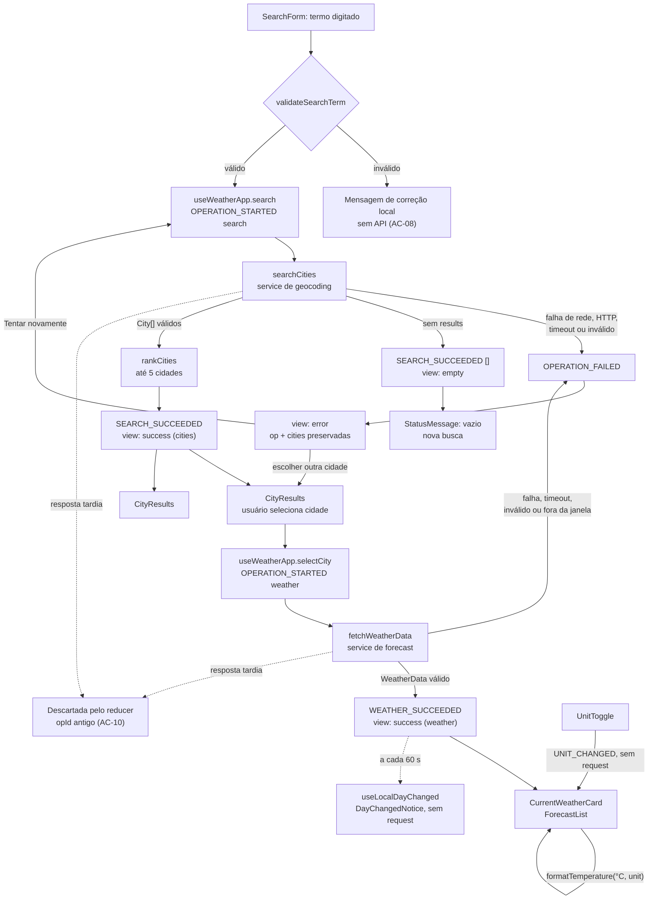

# Plano Técnico — Weather App

Fonte da verdade: [weather-app-spec.md](../specs/weather-app-spec.md).
Este documento define **decisões e contratos** (tipos e assinaturas). Não contém a
implementação. Os IDs `RF-`, `US-`, `AC-`, `RNF-` referem-se à spec e são
rastreados na seção [Rastreabilidade](#rastreabilidade).

## Architecture

**Estilo:** SPA client-side única, sem backend próprio. O navegador chama a
Open-Meteo diretamente por HTTPS (RNF-05, RNF-09). Não há persistência, cache,
polling nem logs externos (RNF-04, RNF-06, RNF-10).

**Camadas (dependência só de cima para baixo):**

```text
components/  (apresentação: recebe props; sem fetch, sem reducer)
     ↓ props
hooks/       (useWeatherApp: dispara ações, aplica timeout, chama serviços)
     ↓                ↓
services/    (fetch + parse de resposta para tipos de domínio; sem React)
     ↓                ↓
lib/         (funções puras: reducer, termos, ranking, temperatura, códigos, datas)
     ↓
types/       (contratos compartilhados)
```

**Princípios:**

- Temperaturas são armazenadas **sempre em °C**. A unidade é só de apresentação
  (RF-06). Trocar a unidade não dispara request (AC-05).
- Toda transição de estado assíncrono passa por um **reducer puro**. Respostas de
  operações substituídas são descartadas no reducer, não só abortadas (AC-10).
- Validação de entrada fica em `lib/` (funções puras). Validação de resposta fica
  em `services/` (parse de `unknown` para tipos de domínio).
- Nenhuma dependência nova de estado (Redux, Zustand, TanStack Query): a spec
  proíbe cache e fallback, e o ganho dessas bibliotecas seria pequeno.

## Tech Stack

Stack já definida em [package.json](../package.json) e nas instruções do projeto.
Este plano a mantém, sem adicionar ferramentas além das listadas como opcionais.

| Camada | Escolha | Justificativa |
|---|---|---|
| Linguagem | TypeScript strict | Contratos de resposta e estados como tipos. |
| UI | React 19 + Vite 8 | Já configurados; SPA simples. |
| Estilo | Tailwind CSS 3.4 (tema dark glassmorphism) | Convenção do projeto; contraste ≥ 4,5:1 (RNF-03). |
| Estado | `useReducer` + hook próprio | Suficiente para uma única árvore de estado sem cache. |
| Dados | `fetch` nativo + `AbortController` | Sem cliente HTTP extra. |
| Datas/fuso | `Intl.DateTimeFormat` com `timeZone` (IANA vindo da API) | Sem biblioteca de datas; o navegador já tem o banco de fusos. |
| Validação de resposta | Type guards escritos à mão | Evita dependência (zod) para ~10 campos. |
| Lint/format | Biome 2.5 | Convenção do projeto. |
| Unit/component | Vitest 4 + Testing Library + jsdom | Convenção do projeto. |
| E2E | Playwright 1.61 (projetos Chromium desktop, Firefox desktop e Chromium com emulação Pixel 7) | RNF-08 exige Chrome e Firefox desktop e Android. Firefox Android é verificação manual (ver Testing Strategy). |
| Acessibilidade | `@axe-core/playwright` (automatizado) + checklist manual | RNF-03 exige verificação automatizada e manual. Axe roda nos fluxos E2E; teclado e leitor de tela ficam no checklist manual. |
| Gerenciador | pnpm 11 | Convenção do projeto. |

**Comandos locais (OQ-02):**

```bash
pnpm dev           # servidor local (HTTP em localhost é permitido, RNF-09)
pnpm lint          # biome lint ./src ./tests
pnpm build         # tsc -b && vite build
pnpm test          # vitest run
pnpm test:e2e      # playwright test
```

## Project Structure

Estrutura alvo. Os caminhos seguem as convenções de
[copilot-instructions](../.github/copilot-instructions.md) (componente por arquivo,
serviços em `services/`, hooks em `hooks/`, tipos em `types/`).

```text
src/
  main.tsx                         # bootstrap React
  App.tsx                          # composição da página; sem lógica de rede
  components/
    SearchForm.tsx                 # campo + botão; valida entrada (RF-01, RF-07)
    CityResults.tsx                # até 5 cidades selecionáveis (RF-02)
    CurrentWeatherCard.tsx         # temperatura atual, condição, horário (RF-03)
    ForecastList.tsx               # hoje + 4 dias (RF-04)
    UnitToggle.tsx                 # Celsius/Fahrenheit (RF-05)
    StatusMessage.tsx              # loading, erro, vazio, timeout (RF-07, RF-08)
    DayChangedNotice.tsx           # orientação após virada do dia (RF-04)
    AttributionFooter.tsx          # atribuição Open-Meteo (RNF-05)
  hooks/
    useWeatherApp.ts               # orquestra reducer, serviços, timeout 15 s
    useLocalDayChanged.ts          # boolean: dia local da cidade mudou (sem request)
  services/
    http.ts                        # fetchJson com status→erro tipado
    openMeteoGeocoding.ts          # searchCities + parseGeocodingResponse
    openMeteoForecast.ts           # fetchWeatherData + parseForecastResponse
  lib/
    searchTerm.ts                  # validateSearchTerm (RF-01)
    cityRanking.ts                 # rankCities: normalização e desempates (RF-02)
    temperature.ts                 # conversão e formatação pt-BR (RF-06)
    weatherCodes.ts                # tabela WMO → descrição pt-BR (RNF-07)
    dateTime.ts                    # localDateKey, formatações no fuso da cidade
    weatherReducer.ts              # reducer puro + ações (sem React)
  types/
    weather.ts                     # Unit, City, CurrentWeather, ForecastDay, WeatherData
    app.ts                         # Operation, ViewState, FailureKind, AppState
  styles/index.css

tests/
  setup.ts
  fixtures/openMeteo/              # respostas controladas (geocoding, forecast, inválidas)
  unit/                            # lib/, services/, reducer
  components/                      # componentes isolados
  integration/App.test.tsx         # fluxo completo com fetch simulado
  e2e/weather.spec.ts              # Playwright: Chromium, Firefox e Pixel 7 (emulação)
```

**Responsabilidades por camada:**

| Camada | Pode importar | Não pode importar | Testada com |
|---|---|---|---|
| `components/` | `types/`, `lib/` (formatação), props | `services/`, `fetch`, reducer | Testing Library, renderização isolada |
| `hooks/` | `services/`, `lib/`, `types/`, React | Nada de DOM específico | Hook com fetch simulado |
| `services/` | `lib/`, `types/` | React, `hooks/`, `components/` | Vitest com respostas em `tests/fixtures/` |
| `lib/` | `types/` | React, `fetch`, `Date.now()` implícito | Vitest puro, sem mocks |

**Regras de dependência:**

- A regra é verificada na Review (grep de imports), não por ferramenta extra. Biome
  não tem regra de camada nativa, e uma ferramenta a mais não se justifica aqui.
- `lib/` recebe o instante atual como parâmetro (`now`), para que `localDateKey` e
  a janela de 5 dias sejam determinísticos nos testes.
- `services/` recebe `fetch` por parâmetro com padrão `globalThis.fetch`, para que
  os testes simulem respostas sem alterar o global.

**Por que essa separação facilita os testes:**

- Regras de negócio críticas (AC-02, AC-04, AC-05, AC-07, AC-10) ficam em
  `lib/` e no reducer. Testá-las não exige DOM, rede nem timers reais.
- O reducer recebe `Action` e devolve `AppState`. Os casos de race (resposta de
  `opId` antigo, AC-10) viram chamadas diretas com sequências de ações.
- `services/` testa o parse de respostas válidas e inválidas com fixtures, sem
  depender do serviço real da Open-Meteo.
- Componentes são burros: recebem props prontas e são testados por estado (loading,
  erro, vazio, dados), sem precisar simular a API.
- Só `useWeatherApp` e o fluxo em `integration/` precisam de todas as camadas juntas.

**Descartado (over-engineering):** repositório de dados, camada de casos de uso,
injeção de dependências por container e Context para estado. A árvore tem um único
hook de estado e um único fluxo de dados; uma camada a mais só adicionaria
indireção.

**Estado atual do repositório:** o commit `Initial commit` continha `src/` e
`tests/` com uma implementação anterior que divergia da spec: timeout de 10 s
(spec: 15 s), campos de vento, pressão, umidade e probabilidade de precipitação
(fora do escopo) e ausência de máquina de estados para descartar respostas
tardias. O commit `entrega inicial` removeu esses arquivos do repositório.

**Decisão:** substituir. O código anterior não será reaproveitado nem restaurado;
a implementação nova parte dos contratos abaixo (fase Code, a partir de T-02).
Justificativa: as divergências (timeout, campos fora do escopo e ausência de
descarte de respostas tardias) atravessam tipos, service, hook e UI, então
adaptar o código antigo exigiria reescrever quase tudo e ainda manter a
rastreabilidade com a spec. A remoção já está no histórico, em commit separado
de qualquer código novo.

## Data Model

Contratos de domínio. Temperaturas sempre em °C.

```ts
// types/weather.ts

/** Unidade de exibição. Afeta só a apresentação; os dados são guardados em °C. */
export type Unit = 'celsius' | 'fahrenheit';

/** Código WMO (`weather_code`). Valores fora da tabela em `lib/weatherCodes.ts` são inválidos. */
export type WeatherCode = number;

/** Cidade do geocoding (`/v1/search`, campo `results[]`). */
export interface City {
  id: number;            // `id`: identificador do provedor; desempate final da ordenação
  name: string;          // `name`: grafia da fonte, sem tradução própria
  country: string;       // `country`: obrigatório; sem ele o item é inválido
  admin1?: string;       // `admin1`: estado/província; opcional, pode não existir
  latitude: number;      // `latitude`: finito, entre -90 e 90
  longitude: number;     // `longitude`: finito, entre -180 e 180
}

/** Estimativa corrente (`current` no `/v1/forecast`). */
export interface CurrentWeather {
  temperatureC: number;  // `current.temperature_2m`: °C, finito
  weatherCode: WeatherCode; // `current.weather_code`: condição atual
  observedAt: string;    // `current.time`: horário do dado no fuso da cidade ('YYYY-MM-DDTHH:mm')
}

/** Um dia da previsão (`daily`, índice i dos arrays). */
export interface ForecastDay {
  date: string;          // `daily.time[i]`: 'YYYY-MM-DD' no calendário local da cidade
  weatherCode: WeatherCode; // `daily.weather_code[i]`: condição do dia
  minC: number;          // `daily.temperature_2m_min[i]`: °C, finito, minC <= maxC
  maxC: number;          // `daily.temperature_2m_max[i]`: °C, finito
}

/** Consulta íntegra da cidade: atual + exatamente 5 dias. Sem sucesso parcial. */
export interface WeatherData {
  city: City;            // cidade selecionada que originou a consulta
  timezone: string;      // `timezone`: IANA válido, devolvido com `timezone=auto`
  current: CurrentWeather;
  days: readonly [ForecastDay, ForecastDay, ForecastDay, ForecastDay, ForecastDay]; // hoje + 4 dias
  queriedAt: string;     // ISO (UTC) em que a resposta foi aceita pelo cliente; não vem da API
}
```

**Mapeamento para a Open-Meteo** (parâmetros em [External APIs](#external-apis)):

| Interface | Campo | Origem na API |
|---|---|---|
| `City` | `id`, `name`, `country`, `admin1`, `latitude`, `longitude` | Geocoding: `id`, `name`, `country`, `admin1`, `latitude`, `longitude` |
| `CurrentWeather` | `temperatureC`, `weatherCode`, `observedAt` | Forecast: `current.temperature_2m`, `current.weather_code`, `current.time` |
| `ForecastDay` | `date`, `weatherCode`, `minC`, `maxC` | Forecast: `daily.time[i]`, `daily.weather_code[i]`, `daily.temperature_2m_min[i]`, `daily.temperature_2m_max[i]` |
| `WeatherData` | `timezone`, `city`, `current`, `days`, `queriedAt` | Forecast: `timezone`; demais campos montados pelo cliente |

Os nomes com sufixo `C` indicam que a unidade é °C por contrato
(`temperature_unit=celsius`), não por conversão implícita. Campos de vento, pressão,
umidade e precipitação não entram nas interfaces (fora do escopo, spec RF-06).

```ts
// types/app.ts

export type FailureKind =
  | 'network'            // falha de rede (fetch rejeitado)
  | 'timeout'            // 15 s sem sucesso
  | 'http'               // status não-2xx
  | 'invalid_response'   // JSON fora do contrato, dados não finitos, janela incompleta, etc.
  | 'out_of_window';     // forecast não contém o dia local atual (cruzou meia-noite)

export type Operation =
  | { kind: 'search'; id: number; term: string }   // term já validado e trimado
  | { kind: 'weather'; id: number; city: City };

export type SuccessContent =
  | { kind: 'cities'; term: string; cities: City[] }              // 1..5 (RF-02)
  | { kind: 'weather'; data: WeatherData; cities: City[] };       // atual + 5 dias (RF-03, RF-04)

export type ViewState =
  | { status: 'idle' }                                             // sem busca (AC-06)
  | { status: 'loading'; op: Operation; cities: City[] }           // cities: mantidas durante consulta de clima
  | { status: 'success'; content: SuccessContent }
  | { status: 'empty'; term: string }                              // RF-07
  | { status: 'error'; op: Operation; failure: FailureKind; cities: City[] };

export interface AppState {
  unit: Unit;            // sessão apenas, inicia em 'celsius' (RF-05)
  nextOpId: number;
  activeOpId: number | null;
  cities: City[];       // última lista de resultados; mantida para trocar de cidade
  view: ViewState;
}
```

**Validação de termo (`lib/searchTerm.ts`):**

```ts
export type SearchTermResult =
  | { ok: true; term: string }
  | { ok: false; reason: 'too_short' | 'numeric_only' | 'coordinates' };

/** Remove espaços externos e conta `[...term].length` (code points Unicode). */
export function validateSearchTerm(raw: string): SearchTermResult;
```

Regras de rejeição (spec, RF-01 e RNF-07):

- `too_short`: menos de 2 caracteres após o trim.
- `numeric_only`: corresponde a `^\d+$`.
- `coordinates`: corresponde a `^[+-]?\d+(\.\d+)?\s*,\s*[+-]?\d+(\.\d+)?$`.

Espaços internos são preservados e o termo não sofre autocorreção.

**Ordenação (`lib/cityRanking.ts`):**

```ts
export const MAX_CITY_RESULTS = 5;

/** Ordena o conjunto recebido e retorna até `limit` itens (AC-02). */
export function rankCities(cities: readonly City[], term: string, limit: number): City[];
```

Regras já fixadas pela spec: categoria (igualdade → prefixo → parcial → demais),
depois cidade, estado (ausente por último), país (comparação `pt-BR` ignorando caixa
e acento) e `id` ascendente. Nome e termo passam por NFD + remoção de `\p{M}` + `toLowerCase()`.
A chamada usa `limit = MAX_CITY_RESULTS`.

**Temperatura (`lib/temperature.ts`):**

```ts
export function toDisplayTemperature(celsius: number, unit: Unit): number;   // F = C × 9/5 + 32
export function roundHalfAwayFromZero(value: number, decimals: number): number;
/** Ex.: (20, 'fahrenheit') → '68,0 °F'; (-1.25, 'celsius') → '−1,3 °C'. */
export function formatTemperature(celsius: number, unit: Unit): string;
```

Arredondamento é aplicado somente na apresentação, a partir do valor original.
Para evitar erro binário (ex.: 1,35 vira 1,3 por imprecisão de ponto flutuante),
o valor é normalizado para 12 dígitos significativos antes de arredondar. Após
arredondar, `-0` vira `0`, para não exibir "−0,0 °C" (ex.: −0,04 °C).

**Horários (`lib/dateTime.ts`):**

```ts
/** `observedAt` ('YYYY-MM-DDTHH:mm', fuso da cidade) → ex.: '11/11/2026, 18:45'. */
export function formatObservedAt(observedAt: string): string;
/** `queriedAt` (ISO UTC) → horário no fuso da cidade, identificado na tela. */
export function formatQueriedAt(queriedAt: string, timezone: string): string;
```

Ambos usam `Intl.DateTimeFormat('pt-BR', …)`. `formatQueriedAt` é obrigatório para
RF-04 ("Mostrar o horário da consulta" no fuso local da cidade, RNF-07).

**Códigos WMO (`lib/weatherCodes.ts`):** mapa fechado `Record<number, string>` com as
descrições em pt-BR (ex.: `0 → 'Céu limpo'`, `3 → 'Nublado'`, `61 → 'Chuva fraca'`,
`95 → 'Trovoada'`). Código fora do mapa é inválido (RF-08).

## Data Flow

**Visão geral (diagrama):**



**Busca (US-01, US-02, US-07):**

```text
SearchForm ──submit(Enter|botão)──► validateSearchTerm(raw)
   ├─ ok=false → mensagem local de correção; NÃO despacha, NÃO chama API (AC-08)
   └─ ok=true  → useWeatherApp.search(term)
                  → dispatch OPERATION_STARTED {op: search, id}
                  → searchCities(term, signal) ──► geocoding
                  → parseGeocodingResponse → City[]
                  → rankCities(cities, term, 5)
                  → dispatch SEARCH_SUCCEEDED {opId, cities}
                       ├─ [] → view.status = 'empty'
                       └─ [..] → view.status = 'success' (content.kind = 'cities')
```

**Seleção e consulta (US-03, US-04):**

```text
CityResults ──click/Enter em um item──► useWeatherApp.selectCity(city)
   → dispatch OPERATION_STARTED {op: weather, id}     // limpa clima anterior
   → fetchWeatherData(city, now, signal) ──► forecast
   → parseForecastResponse → valida janela e fuso
   → dispatch WEATHER_SUCCEEDED {opId, data}
```

**Unidade (US-05, US-06):**

```text
UnitToggle ──► dispatch UNIT_CHANGED   (sem request, sem reinício de prazo)
Componentes de clima ──► formatTemperature(originalCelsius, state.unit)
```

**Virada do dia (US-04, AC-04):**

```text
useLocalDayChanged(data) — a cada 60 s compara localDateKey(data.timezone, agora)
com data.days[0].date. Se diferente → DayChangedNotice orienta nova seleção.
Não há request automático.
```

**Retry (US-08, AC-10):** `view.status = 'error'` guarda o `op` original. "Tentar
novamente" despacha a mesma `Operation` com novo `id` e novo prazo de 15 s.

## External APIs

Duas chamadas, ambas sem API key, feitas do navegador por HTTPS. Os termos de uso,
limites e atribuição devem ser conferidos antes das primeiras chamadas reais (OQ-01).

### 1. Geocoding

`GET https://geocoding-api.open-meteo.com/v1/search`

| Parâmetro | Valor | Motivo |
|---|---|---|
| `name` | termo validado (sem trim alterado internamente) | RF-01, sem autocorreção |
| `count` | `10` | Busca 10 candidatos; a UI mostra 5 após ordenação (AC-02). Trade-off em Risks. |
| `language` | `pt` | Nomes de país no idioma da UI; grafia do provedor preservada (RNF-07). |
| `format` | `json` | Explícito. |

URL completa de exemplo: `https://geocoding-api.open-meteo.com/v1/search?name=Berlin&count=10&language=pt&format=json`

Exemplo de resposta (resumido; a API devolve mais campos, como `country_code`, `timezone`, `population`, que não são usados):

```json
{
  "results": [
    {
      "id": 2950159,
      "name": "Berlim",
      "latitude": 52.52437,
      "longitude": 13.41053,
      "country": "Alemanha",
      "admin1": "Berlim"
    }
  ],
  "generationtime_ms": 0.19
}
```

**Ausência de `results`** é lista vazia (AC-09). Resposta com `results` que não é
array ou item sem campo obrigatório é `invalid_response`, não lista vazia (spec: "estrutura inválida não equivale a lista vazia").

**Mapeamento para `City`:**

| Campo da resposta | Campo de `City` | Regra |
|---|---|---|
| `id` | `id` | obrigatório, inteiro |
| `name` | `name` | obrigatório, string, sem tradução no cliente |
| `country` | `country` | obrigatório; ausente → item inválido |
| `admin1` | `admin1` | opcional; omitir a chave se ausente |
| `latitude` / `longitude` | `latitude` / `longitude` | obrigatórios, finitos, dentro da faixa |

A ordem dos candidatos é aplicada por `rankCities` (`cityRanking.ts`), conforme a regra da spec em "Regras de busca e apresentação → Ordenação": categoria (igualdade, prefixo, ocorrência parcial, demais), depois cidade, estado/província (ausente por último), país e, por fim, `id` ascendente.

### 2. Forecast

`GET https://api.open-meteo.com/v1/forecast`

| Parâmetro | Valor |
|---|---|
| `latitude`, `longitude` | da `City` selecionada |
| `current` | `temperature_2m,weather_code` |
| `daily` | `weather_code,temperature_2m_max,temperature_2m_min` |
| `forecast_days` | `5` (hoje + 4) |
| `timezone` | `auto` (datas e horários no fuso da cidade; devolve o IANA) |
| `temperature_unit` | `celsius` (explícito; a conversão é feita no cliente) |

URL completa de exemplo (Berlim):
`https://api.open-meteo.com/v1/forecast?latitude=52.52&longitude=13.41&current=temperature_2m,weather_code&daily=weather_code,temperature_2m_max,temperature_2m_min&forecast_days=5&timezone=auto&temperature_unit=celsius`

Exemplo de resposta (resumido; valores de uma consulta real, sem os `*_units` e metadados):

```json
{
  "latitude": 52.512604,
  "longitude": 13.419517,
  "utc_offset_seconds": 3600,
  "timezone": "Europe/Berlin",
  "timezone_abbreviation": "GMT+1",
  "current": {
    "time": "2026-11-11T18:45",
    "interval": 900,
    "temperature_2m": 3.9,
    "weather_code": 3
  },
  "daily": {
    "time": ["2026-11-11", "2026-11-12", "2026-11-13", "2026-11-14", "2026-11-15"],
    "weather_code": [3, 61, 80, 3, 2],
    "temperature_2m_max": [5.1, 6.3, 8.0, 7.8, 7.8],
    "temperature_2m_min": [2.0, 3.2, 2.0, 2.8, 0.9]
  }
}
```

**Mapeamento para os tipos:**

| Campo da resposta | Tipo de destino | Regra |
|---|---|---|
| `timezone` | `WeatherData.timezone` | IANA válido |
| `current.time` | `CurrentWeather.observedAt` | `YYYY-MM-DDTHH:mm`, no fuso da cidade |
| `current.temperature_2m` | `CurrentWeather.temperatureC` | °C, finito |
| `current.weather_code` | `CurrentWeather.weatherCode` | código WMO na tabela |
| `daily.time[i]` | `ForecastDay.date` (i = 0..4) | `YYYY-MM-DD`, consecutivas |
| `daily.weather_code[i]` | `ForecastDay.weatherCode` | código WMO na tabela |
| `daily.temperature_2m_min[i]` | `ForecastDay.minC` | °C, finito, `minC <= maxC` |
| `daily.temperature_2m_max[i]` | `ForecastDay.maxC` | °C, finito |
| — | `WeatherData.city`, `WeatherData.queriedAt` | montados pelo cliente, não vêm da API |

`parseForecastResponse` converte os arrays `daily` em `days: [ForecastDay x5]` por
índice e rejeita a resposta se os comprimentos divergirem.

**Validações em `parseForecastResponse`** (todas ou erro `invalid_response`):

- `timezone` aceito por `Intl.DateTimeFormat` com `timeZone`.
- `current`: temperatura finita, código na tabela WMO, `time` no formato esperado.
- `daily`: exatamente 5 datas, consecutivas e distintas, temperaturas finitas,
  `min <= max`, códigos na tabela.
- **Janela vigente:** `days[0].date === localDateKey(timezone, agora)` e `days[4].date`
  igual a esse dia + 4 dias; caso contrário `out_of_window` (spec: erro recuperável,
  sem datas fabricadas). Uma resposta obtida antes da meia-noite, com `days[0]` igual
  a ontem, é rejeitada, pois a spec exige "hoje + quatro dias" vigentes.

## State Management

**Onde vive:**

| Estado | Local | Motivo |
|---|---|---|
| Unidade | `AppState.unit` (reducer) | Sessão da página; sem persistência (RF-05). |
| Resultados e clima | `AppState.view` / `cities` | Única fonte; descarte por `activeOpId`. |
| Mensagem de correção do termo | `SearchForm` (estado local) | Não é operação; nunca chega ao reducer. |
| Prazo de 15 s | `useWeatherApp` (`setTimeout` por operação) | Efeito colateral isolado do reducer. |
| Dia mudou | `useLocalDayChanged` (boolean derivado) | Sem request. |

**Reducer (`lib/weatherReducer.ts`):**

```ts
export type Action =
  | { type: 'OPERATION_STARTED'; op: Operation }
  | { type: 'SEARCH_SUCCEEDED'; opId: number; cities: City[] }
  | { type: 'WEATHER_SUCCEEDED'; opId: number; data: WeatherData }
  | { type: 'OPERATION_FAILED'; opId: number; failure: FailureKind }
  | { type: 'UNIT_CHANGED'; unit: Unit };

export function weatherReducer(state: AppState, action: Action): AppState;
```

Regras do reducer:

- `SEARCH_SUCCEEDED`, `WEATHER_SUCCEEDED`, `OPERATION_FAILED` com `opId !== activeOpId`
  retornam o **mesmo** `state` (AC-10: resposta tardia não altera tela).
- `OPERATION_STARTED` de busca limpa `cities` e clima; de clima mantém `cities` e
  limpa o clima anterior (spec: "nova seleção limpa o clima/previsão anterior").
- `UNIT_CHANGED` altera apenas `unit`.

**Estados explícitos (`ViewState.status`):**

| Estado | Quando | Dados no estado | Ações permitidas |
|---|---|---|---|
| `idle` | Início da página, sem busca (AC-06) | — | Buscar |
| `loading` | Busca ou consulta de clima em andamento | `op`; em consulta de clima, `cities` anteriores | Nova ação substitui a operação; prazo de 15 s |
| `success` | Busca com ≥ 1 cidade (`content.kind = 'cities'`) ou clima completo (`content.kind = 'weather'`) | `cities`, e `data` quando há clima | Selecionar cidade, trocar unidade, buscar |
| `empty` | Geocoding sem resultados (RF-07, AC-09) | `term` | Nova busca |
| `error` | Falha de uma operação (`FailureKind`) | `op` (para "Tentar novamente"), `cities` | Tentar novamente, escolher outra cidade, buscar |

`success` é um único status com discriminador `content.kind`; a UI escolhe a
visualização a partir dele. Erro nunca é `empty`, e `empty` nunca tem clima.

**Conversão de unidade (derivada na renderização, sem request):**

- O estado guarda **só** temperaturas em °C (`CurrentWeather.temperatureC`,
  `ForecastDay.minC`, `ForecastDay.maxC`) e `unit`. Nenhum campo armazena Fahrenheit.
- Componentes chamam `formatTemperature(celsius, unit)` na renderização. Trocar a
  unidade muda `AppState.unit`, e o reducer não emite efeito nem request (AC-05).
- `UNIT_CHANGED` altera apenas `unit`; o status, os dados e `cities` permanecem.
- Arredondamento de 1 casa decimal, metade para longe de zero, conforme RF-06.

```ts
// lib/temperature.ts (funções puras)
export function toDisplayTemperature(celsius: number, unit: Unit): number; // C → F: C × 9/5 + 32
export function formatTemperature(celsius: number, unit: Unit): string;    // ex.: "20,0 °C", "68,0 °F"
```

**Hook (`hooks/useWeatherApp.ts`):**

```ts
export interface WeatherAppDeps {
  searchCities: typeof searchCities;
  fetchWeatherData: typeof fetchWeatherData;
  now: () => Date;
  timeoutMs: number;     // 15_000 em produção; injetável em teste
}

export interface WeatherApp {
  state: AppState;
  search(term: string): void;   // assume termo já validado
  selectCity(city: City): void;
  retry(): void;
  setUnit(unit: Unit): void;
}

export function useWeatherApp(deps?: Partial<WeatherAppDeps>): WeatherApp;
```

Uma `AbortController` ativa por vez. Nova operação aborta a anterior, cancela seu
timer e incrementa `nextOpId`. O timer de 15 s dispara `OPERATION_FAILED` com
`timeout` e aborta a requisição. O timer é cancelado quando a resposta é aceita
(sucesso ou falha de validação). `timeoutMs` é 15 000 em produção e nos testes.

## Error Handling

| Situação | Detecção | Resultado na UI | Spec |
|---|---|---|---|
| Termo < 2 caracteres, vazio ou só espaços | `validateSearchTerm` | Mensagem: "Digite pelo menos 2 caracteres." Sem API. | AC-08 |
| Só dígitos | `validateSearchTerm` | "Busque pelo nome da cidade; códigos postais não são suportados." Sem API. | AC-08 |
| Par numérico (ex.: `-23.55, -46.63`) | `validateSearchTerm` | "Busque pelo nome da cidade; coordenadas não são suportadas." Sem API. | AC-08 |
| Geocoding sem `results` | `services` | `view.status = 'empty'`: "Nenhuma cidade encontrada." Permite nova busca. | AC-09 |
| Geocoding com item inválido | `parseGeocodingResponse` | `error` / `invalid_response`. Não é "vazio". | Edge cases |
| Falha de rede | `fetchJson` (TypeError) | `error` / `network`. | Edge cases |
| HTTP não-2xx | `fetchJson` | `error` / `http`. | Edge cases |
| 15 s sem sucesso | timer em `useWeatherApp` | `error` / `timeout`. | RF-08, AC-10 |
| Forecast inválido ou incompleto | `parseForecastResponse` | `error` / `invalid_response`. Sem sucesso parcial. | RF-08 |
| Cruzou meia-noite sem janela vigente | `parseForecastResponse` | `error` / `out_of_window`, recuperável. | AC-04 |
| Virada após sucesso | `useLocalDayChanged` | Aviso e orientação para selecionar de novo. Dados antigos ficam com datas originais. | AC-04 |
| Resposta tardia de operação substituída | reducer (`opId`) | Ignorada. | AC-10 |

**Estratégia por tipo de falha:**

- **Rede (`network`):** `fetch` rejeitado, sem resposta. Sem retry automático (spec);
  "Tentar novamente" reenvia a mesma `Operation` com novo `id` e novo prazo.
- **API (`http`):** status não-2xx. O corpo de erro não é interpretado nem exibido;
  a mensagem é a genérica de falha e o retry é o mesmo do caso de rede.
- **Timeout (`timeout`):** 15 s desde a ação (RF-08). O prazo é encerrado quando a
  resposta é aceita pelo reducer; o `AbortController` cancela a requisição, e resposta
  que chegar depois é descartada pelo `opId` (AC-10). A spec inclui a renderização no
  prazo: o E2E (F4 e RNF-02) mede do envio até o DOM renderizado e exige ≤ 15 s.
- **Resposta parcial ou inválida (`invalid_response`):** qualquer campo ausente,
  não finito, `daily` com número de dias diferente de 5, ou `timezone` inválido
  reprova a resposta inteira. `WeatherData` é tudo ou nada: não há renderização
  parcial.
- **Janela vigente (`out_of_window`):** a previsão não cobre o dia local atual da
  cidade. Erro recuperável; nenhuma data é inventada.
- **Lista vazia não é erro:** `empty` só vem de geocoding sem resultados. Falha de
  parse no geocoding é `invalid_response`.
- Em todo `error`, `cities` é preservada, para o usuário escolher outra cidade sem
  nova busca.

**Mensagens:** mapeadas a partir de `FailureKind` em `StatusMessage`, em pt-BR e
sempre com botão "Tentar novamente" (exceto `empty`). Erros são anunciados com
`role="alert"` e carregamento com `aria-live="polite"` (RNF-03). Texto da API é
renderizado como texto, nunca HTML (RNF-09).

**Logs (RNF-10):** somente `console` local, com operação (`search`/`weather`),
resultado, duração em ms e status HTTP. Nunca o termo, o nome da cidade, coordenadas
ou corpo da resposta.

## Testing Strategy

Pirâmide: lógica pura em muitos testes unitários; componentes e fluxo com fetch
simulado; E2E curto e focado em jornadas e viewports. Os testes **não** dependem da
disponibilidade real da Open-Meteo (spec, AC).

| Nível | Ferramenta | Escopo | ACs cobertos |
|---|---|---|---|
| Unit (`lib/`) | Vitest | `validateSearchTerm`, `rankCities` (parametrizado: igualdade, prefixo, acento, caixa, homônimos, estado ausente), `toDisplayTemperature` e `formatTemperature`, `roundHalfAwayFromZero` (20 → 68,0; 1,25 → 1,3; −1,25 → −1,3; 1,35 → 1,4), `weatherCodes` | AC-01, AC-02, AC-07, AC-08 |
| Unit (`services/`) | Vitest + `fetch` simulado | Parse de fixtures válidas, inválidas (não finito, min > max, código desconhecido, 4 ou 6 dias, fuso inválido, janela fora do dia) e de HTTP/rede | AC-03, AC-04, AC-09 |
| Unit (reducer) | Vitest | Transições; resposta de `opId` antigo não muda estado; troca de unidade não muda `view` | AC-05, AC-10 |
| Hook | Vitest + fake timers | Timeout disparado com `timeoutMs` = 15 000 no teste; sucesso antes do prazo cancela o timer; retry reinicia o prazo com os mesmos parâmetros; resposta substituída não sobrepõe sucesso mais recente | AC-10 |
| Componentes: sucesso | Testing Library | `CityResults` com 1 a 5 itens (teclado, seleção por clique e Enter); `CurrentWeatherCard` com 20,0 °C e "Estimativa meteorológica"; `ForecastList` com 5 dias e datas formatadas em `timeZone: 'UTC'`; `UnitToggle` com estado acessível | AC-01, AC-03, AC-04, AC-05, AC-07 |
| Componentes: loading | Testing Library | `StatusMessage` com `aria-live="polite"`; `CityResults` mantém as cidades visíveis durante a consulta de clima | AC-03 |
| Componentes: erro | Testing Library | `StatusMessage` com `role="alert"` para cada `FailureKind`; botão "Tentar novamente" presente, exceto em `empty` | RF-08, AC-10 |
| Componentes: vazio | Testing Library | `StatusMessage` com "Nenhuma cidade encontrada."; `SearchForm` mantém o termo digitado | AC-09 |
| Componentes: entrada | Testing Library | `SearchForm` (Enter e botão; mensagens de correção sem chamada à API) | AC-08 |
| Integração | Vitest + `fetch` simulado | `App` com fluxo busca → seleção → clima; estado inicial sem cidade e Celsius; troca de unidade não chama `fetch` | AC-03, AC-05, AC-06 |
| E2E | Playwright (Chromium desktop, Firefox desktop e Pixel 7) | Jornadas completas com `page.route`; relógio com `page.clock`; timeout com resposta atrasada > 15 s medido até o DOM renderizado; recarga restaura Celsius; viewports 320, 375, 768 e 1920 px sem rolagem horizontal; alvos ≥ 44 px | AC-01 a AC-10, RNF-01, RNF-02, RNF-08 |
| Acessibilidade | Playwright + `@axe-core/playwright` (automatizado) e checklist manual | Axe sem violações nas telas de sucesso, erro e vazio; teclado, foco visível, leitor de tela, contraste ≥ 4,5:1 | RNF-03 |
| Integração real (manual) | Navegador local (desktop e Android) | Uma busca e uma consulta reais, registrando navegador, versão, SO, dispositivo (Android), latência e status. Firefox Android entra aqui, pois não há projeto Playwright para ele. | RNF-02, RNF-08, OQ-02 |

**Fluxos E2E (Playwright, Chromium desktop, Firefox desktop e Pixel 7):**

- **F1 Busca → seleção → clima:** AC-01, AC-02, AC-03. Com `page.route` devolvendo fixtures.
- **F2 Termo inválido:** AC-08. Confere que nenhuma requisição foi feita.
- **F3 Cidade sem resultados:** AC-09. Mensagem de vazio e nova busca possível.
- **F4 Timeout:** AC-10, RF-08. Resposta atrasada com mais de 15 s; `page.clock` controla o prazo.
- **F5 Virada do dia:** AC-04. `page.clock` avança a meia-noite local; aviso aparece e nenhuma requisição nova é feita.
- **F6 Unidade:** AC-05, AC-06. Troca não gera requisição; recarregar a página volta a Celsius sem cidade.
- **F7 Responsivo:** RNF-01. Viewports 320, 375, 768 e 1920 px sem rolagem horizontal e alvos ≥ 44 px.
- **F8 Mobile (Pixel 7):** RNF-08. Repete F1 e F4 com emulação Android no Chromium.

**Regras de teste:**

- Nenhum teste automatizado chama a API real. Usar `tests/fixtures/openMeteo/`.
- Datas e fusos são controlados (`now` injetado e `timezone` explícito); nunca depender do fuso da máquina.
- Datas dos dias de previsão são formatadas com `timeZone: 'UTC'` para evitar deslocamento de um dia.
- Cada critério de aceite tem pelo menos um teste nomeado com o ID (ex.: `AC-07: 1,25 °C vira 1,3 °C`).

**Comandos de validação da fase Code:** `pnpm lint`, `pnpm build`, `pnpm test`,
`pnpm test:e2e`. As evidências registram resultado (passou/falhou), não só o comando, e ficam em
`plans/evidencias.md`.

## Risks & Trade-offs

| Decisão / Risco | Alternativa considerada | Trade-off e mitigação |
|---|---|---|
| Chamadas diretas do navegador à Open-Meteo | Proxy próprio (BFF) | Mais simples e sem servidor; a Open-Meteo não exige chave. Depende de CORS e dos limites do provedor (OQ-01). |
| `count=10` no geocoding | `count=5` ou `count=100` | 10 dá candidatos para ordenar sem exagerar no payload. Não prometemos cobertura global (spec). |
| `useReducer` próprio | TanStack Query / Zustand | Spec proíbe cache e retry automático; biblioteca traria comportamento que precisaria ser desligado. |
| Type guards à mão | zod | Menos dependências; o contrato tem poucos campos. Risco: manutenção se a API mudar. Mitigado por fixtures e testes de parse. |
| Validar janela de 5 dias no parse | Aceitar e exibir | Evita datas fabricadas após meia-noite (spec). Custo: uma consulta cruzando meia-noite vira erro recuperável. |
| Verificação de virada a cada 60 s (sem request) | Timer até a próxima meia-noite | Simples e robusto a mudança de fuso/suspensão do navegador. Não atualiza dados (spec). |
| Arredondamento com normalização de 12 dígitos | `toFixed(1)` | `toFixed` arredonda empates binários de forma inconsistente e não é "afastado de zero". Custo: uma função extra coberta por teste. |
| `language=pt` no geocoding | Idioma padrão do provedor | Nomes de país em pt-BR. Nomes de cidades continuam na grafia da fonte (RNF-07). |
| Latência ou contrato da API mudarem | Cache local ou fallback de dados | Spec proíbe cache e fallback. Mitigado por timeout de 15 s, erro recuperável e fixtures que detectam mudança de contrato. |
| Divergência do código existente | Reaproveitar o código atual | Decidido: substituir (ver Project Structure). Custo: reescrever tudo; benefício: aderência à spec sem remendos. |
| Termos/atribuição da Open-Meteo | Ignorar por ser local | Pré-requisito antes de chamadas reais (OQ-01); atribuição visível em `AttributionFooter` (RNF-05). |
| Acessibilidade e responsividade | Validação só visual | Risco de falha em leitor de tela e mobile; mitigado por checklist manual e Playwright nos viewports da spec. |
| Vitest + Testing Library | Jest | Vitest já é a convenção do projeto e reaproveita a configuração do Vite; menos configuração de transformação. |
| E2E com API simulada (`page.route`) | E2E contra a Open-Meteo real | Determinístico e sem depender de rede ou de limites do provedor. Custo: a simulação pode divergir da API; a integração real fica como checagem manual (OQ-02). |
| `page.clock` para a virada do dia | Esperar a meia-noite real | Rápido e determinístico. A regra de `now` injetado cobre a lógica nos testes unitários. |
| Fake timers no hook (Vitest) | Timers reais | Testa o prazo de 15 s sem esperar. Custo: usar `advanceTimersByTimeAsync` para não pular promessas pendentes. |
| Playwright em Chromium, Firefox e Pixel 7 | Só Chromium | RNF-08 exige Chrome e Firefox desktop e Android. Custo: mais tempo de CI. Firefox Android não é automatizado; coberto manualmente. |

## Rastreabilidade

| Requisito | Seção do plano | Componentes / contratos principais |
|---|---|---|
| RF-01 | Data Model (`validateSearchTerm`), Data Flow (busca) | `SearchForm`, `lib/searchTerm.ts` |
| RF-02 | Data Model (`rankCities`), External APIs | `CityResults`, `lib/cityRanking.ts` |
| RF-03 | Data Model (`CurrentWeather`), Data Flow (seleção) | `CurrentWeatherCard` |
| RF-04 | Data Model (`ForecastDay`), State Management (`useLocalDayChanged`) | `ForecastList`, `DayChangedNotice` |
| RF-05 | State Management (`unit`), Data Flow (unidade) | `UnitToggle`, `AppState.unit` |
| RF-06 | Data Model (`formatTemperature`) | `lib/temperature.ts` |
| RF-07 | Error Handling (validação e vazio) | `SearchForm`, `StatusMessage` |
| RF-08 | State Management (timeout), Error Handling | `useWeatherApp`, `weatherReducer` |
| US-01 (RF-01) | Testing Strategy (F1, F2); `SearchForm`, `lib/searchTerm.ts` | AC-01 |
| US-02 (RF-02) | Data Model (`rankCities`); Testing Strategy (F1) | AC-02 |
| US-03 (RF-03) | Data Model (`CurrentWeather`); `CurrentWeatherCard` | AC-03 |
| US-04 (RF-04) | State Management (`useLocalDayChanged`); Testing Strategy (F5) | AC-04 |
| US-05 (RF-05) | State Management (`unit`); Testing Strategy (F6) | AC-05, AC-06 |
| US-06 (RF-06) | Data Model (`formatTemperature`); Testing Strategy (unitários) | AC-07 |
| US-07 (RF-07) | Error Handling (validação e vazio); Testing Strategy (F2, F3) | AC-08, AC-09 |
| US-08 (RF-08) | State Management (timeout); Testing Strategy (F4) | AC-10 |
| AC-01 a AC-10 | Testing Strategy | Testes nomeados por ID |
| RNF-01 | Testing Strategy (E2E viewports), Tech Stack (Tailwind) | Layout responsivo |
| RNF-02 | Testing Strategy (E2E F4, integração real manual) | `useWeatherApp` (timeout) |
| RNF-04 | Error Handling (timeout, retry manual, respostas expiradas) | `weatherReducer`, `useWeatherApp` |
| RNF-06 | Architecture (sem persistência); Error Handling (logs sem termo) | `services/`, sem `localStorage` |
| RNF-08 | Tech Stack (E2E), Testing Strategy (F8 e integração manual) | Projetos Playwright |
| RNF-09 | Error Handling e Data Flow (texto, não HTML; validação de tipos) | `services/openMeteo*`, `StatusMessage` |
| RNF-10 | Error Handling (logs somente no console local) | `services/`, `useWeatherApp` |
| RNF-03 | Error Handling (`role`), Testing Strategy (a11y) | Todos os componentes |
| RNF-05 | External APIs, Architecture | `services/`, `AttributionFooter` |
| RNF-07 | Data Model (`weatherCodes`), Data Flow (texto pt-BR) | `lib/weatherCodes.ts`, `lib/dateTime.ts` |
